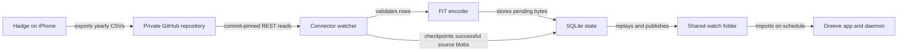

# Architecture

## Overview

The connector has one outbound source and one filesystem destination. Dreeve's importer runs independently after publication:



## Components

### Configuration and CLI

`config.py` validates startup settings and reads credentials. `cli.py` selects `check`, `preview`, `sync`, or `watch`, emits summaries, handles signals, and delays watcher retries. Each cycle creates and closes a GitHub client, allowing token-file rotation.

### GitHub reader

`github.py` resolves the branch to a commit, discovers matching yearly files, and downloads raw CSVs at that commit. The snapshot carries repository ID, commit SHA, and source file paths/blob SHAs. Redirects are disabled. Sanitized errors avoid HTTP bodies and credentials.

### Parser and FIT encoder

`workout.py` converts bytes into normalized immutable `Workout` objects and row rejections. It validates time bounds, UUIDs, numeric ranges, and required headers. `fit.py` maps supported sports and creates summary FIT bytes with `fit-tool`. It creates no GPS or sensor samples.

### Sync coordinator

`sync.py` owns filtering, deduplication, change detection, file caching, and counters. Mutating runs acquire `sync.lock` without waiting. Preview opens state read-only and performs no file publication or checkpoints.

### State and publication

`state.py` stores SQLite state and publishes files using temporary files in the destination directory. It flushes and fsyncs content, sets mode `0644`, then atomically replaces the stable final `.fit` filename. On non-Windows systems it also fsyncs the containing directory. The importer never sees a partially written `.fit`.

## Data flow

1. Validate that watch and state paths differ; acquire the state lock for mutating runs.
2. Replay every pending delivery before reading a new GitHub snapshot.
3. Resolve the snapshot and calculate cache scope from repository ID and `EXPORT_SINCE`.
4. Skip source blobs whose checkpoint matches. Parse all others and report rejected rows.
5. Filter old starts, compare fingerprints for seen UUIDs, and encode new valid workouts.
6. Commit each pending payload to SQLite, publish it, then mark it delivered and clear the stored payload.
7. Checkpoint a source file only if parsing and encoding completed without rejections.

For example, a first `sync` with the synthetic fixture delivers one file. A second run with the same blob records `cached_files=1`. Changing the date filter changes the cache scope but does not remove workout identities.

## State schema

| Table | Key | Other fields | Purpose |
| --- | --- | --- | --- |
| `workouts` | `(repo, uuid)` | `fingerprint`, `filename`, `payload`, `status` | Repository ID and workout identity, pending bytes, delivery acknowledgment |
| `files` | `(repo, path)` | `sha` | Here `repo` is the composite cache scope `repository-ID:since-or-all`; tracks fully processed blobs |

`status` transitions from `pending` to `delivered`; delivered rows retain metadata but clear `payload`. No Dreeve import acknowledgment is stored.

## Directory layout

```text
src/dreeve_hadge_connector/
  cli.py           Commands, logging, watcher lifecycle
  config.py        Environment and credential validation
  github.py        Snapshot and raw-file HTTP access
  workout.py       Hadge CSV parsing and normalized identity
  fit.py           Summary FIT generation and sport mapping
  sync.py          Delivery coordination and source checkpoints
  state.py         SQLite, locking boundary, atomic publication
tests/             Unit tests and Docker acceptance harness
scripts/           Release validation and downloadable setup assets
.github/workflows/ Tests, release publishing, documentation
docker-compose.yml Standalone release deployment
```

## Delivery boundary

SQLite and Dreeve's filesystem importer do not share a transaction. A crash after publication but before database acknowledgment can republish the same file after restart. Delivery is at least once; Dreeve's duplicate detection handles this window. Separate persistent state remains necessary because Dreeve consumes watched files. [Recovery](./recovery.md) describes operational consequences.
